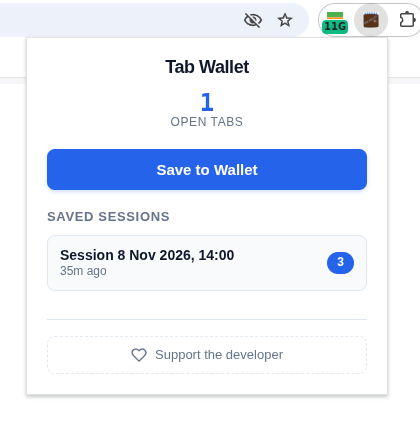
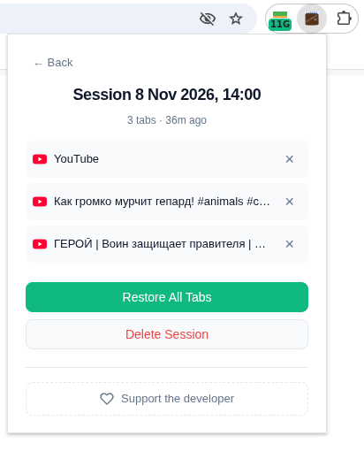

# Tab Wallet

A simple, private, and efficient tab session manager for Google Chrome and Chromium-based browsers. Save open tabs for later and free up RAM. Restore saved tabs when you want. All data stays on your device

---

## Features

- **One-Click Session Saving**: Capture all open, non-system (and not pinned) tabs in the current window with an auto-generated or custom name.
- **Instant RAM Relief**: Built-in option to automatically close saved tabs, freeing up memory immediately after saving.
- **Granular Control**: View saved sessions, restore all tabs at once, delete entire sessions, or remove individual tabs from a saved session.
- **Modern UI**: Clean, accessible interface with clear metadata (tab count, time elapsed), smooth interactions, and built-in favicon support.
- **100% Local & Private**: Your sessions are saved exclusively in `chrome.storage.local`. No data is ever sent to external servers.

---

## Screenshots

  
  

  <em>Main popup showing open tabs count and saved sessions</em>

---

## Privacy & Permissions

Tab Wallet is built with a "Privacy-First" philosophy. It requests only the absolute minimum permissions required to function:

- **`tabs`**: To read tab URLs/titles for saving and to close them on user request. **We do not read, track, or store your browsing history or tab content.**
- **`storage`**: To save and load your tab sessions locally on your device.
- **`favicon`**: To display website icons in the popup UI for better visual recognition.

Read the full, detailed policy here: **[POLICY](docs/POLICY)**

---

## License

This project is open-source and licensed under the **MIT License** — see the [LICENSE](docs/LICENSE) file for details.

---

